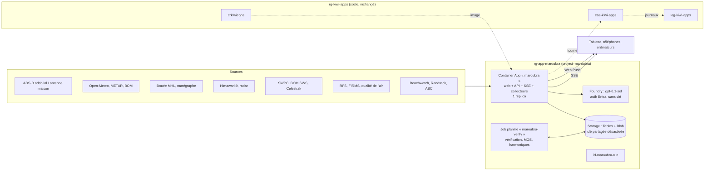

# Maroubra : plan du projet (v2)

> An ambient window on Maroubra: the sky, the sea, the beach, the weather and the night, read like an expert would, and right more often than any app on your phone.

Site en anglais, documentation en français. Hébergé sur le socle kiwi-apps : `https://maroubra.apps.akakiwi.com` (nom à confirmer).

Point de départ : les maquettes Claude Design ([canvas « Écran d'accueil Maroubra »](https://claude.ai/artifact/45BCE2BgPjavgj64SqYdp4)). La **direction B « Bord de mer »** est retenue pour le jour (Manrope, `#EEF3F5`, `#0E2A3B`, `#0B6E99`, `#D9481F`). La **direction A « Nuit »** devient le thème de nuit.

Ce qui change par rapport à la v1 :

- Le plan est construit avec le skill `/be-ambitious` : on vise mieux, pas plus gros.
- Retirés : trajets, agenda, tâches, trafic (trop personnels, ou pas demandés).
- Le site est pour **la famille**, en **anglais**, et **s'adapte** à l'ordinateur, à la tablette et au téléphone.
- Les actualités sont **locales** (Randwick, Maroubra), en anglais.
- Les photos (dossier OneDrive personnel) sont reportées à un lot futur ; aucune vue photo dans cette version.

---

## Partie A : l'ambition

### A.1 Le but derrière le but

Un écran d'accueil n'est qu'un moyen. Le vrai but est que **la famille ne rate plus les moments que Maroubra offre** : la baignade parfaite, le lever de soleil incendiaire sur la mer, la lune qui se lève sur l'océan, l'ISS qui passe à 19 h 42, l'A380 qui arrive, la fumée qui approche. Et que la famille puisse **faire confiance** à ce que l'écran annonce, parce qu'il a prouvé qu'il a raison.

### A.2 Les types d'ambition retenus

| Type | Retenu ? | Pourquoi |
|---|---|---|
| **Altitude** | Oui | L'écran sert une décision (« on y va ? », « on se lève ? », « on sort regarder ? »). On peut viser cette décision, pas l'affichage. |
| **Depth** | Oui | C'est là que le projet devient exceptionnel : partir des données brutes (bouée, marégraphe, radar, satellite, éphémérides, signaux ADS-B) et **vérifier chaque prévision contre la réalité**. |
| **Range** | Oui | Le ciel, la mer et la plage relèvent de métiers précis (prévisionniste, océanographe, sauveteur, astronome, photographe, contrôleur aérien). Leurs méthodes donnent les fonctionnalités. |
| Speed | Non | Le skill l'écarte toujours. |

Règle appliquée partout : **mieux, pas plus gros**. Aucune vue n'est ajoutée sans données réelles pour la nourrir et un juge extérieur pour la vérifier. C'est pour ça que la bioluminescence, les baleines et les requins ne sont **pas** des vues : je n'ai trouvé ni flux public ni méthode de prévision vérifiable (voir A.6).

### A.3 Altitude : l'échelle à trois barreaux

1. **Comprendre, pas afficher.** Chaque donnée est traduite en sens local. Pas « Wind NE 18 km/h », mais « Onshore breeze, choppy surf, bluebottles likely ». Pas « Cloud 40 % », mais « Broken high cloud east: sunrise could be spectacular ».
2. **Arriver aux décisions.** L'écran répond à « qu'est-ce qui vaut le coup dans les prochaines 24 h ? » par des **moments** datés, avec un créneau et une confiance : « Best swim 10:00 to 13:00 (high confidence) », « Moonrise over the sea 18:52 », « ISS visible 19:42, NW to SE, 5 min ». Chaque membre de la famille choisit les moments qu'il veut recevoir sur son téléphone.
3. **Remplacer le rituel.** Aujourd'hui, savoir tout ça demande une dizaine d'apps : BOM, Willyweather, Beachsafe, Surfline, Flightradar24, Heavens-Above, SpaceWeatherLive, Fires Near Me, Beachwatch. Le but est une **source unique, plus juste localement que chacune d'elles**, et qui le **prouve** : un carnet de vérification public (« Track record ») compare chaque prévision à l'observation et à la prévision brute du modèle. L'écran apprend ses propres biais locaux et les corrige.

**Mise en place nécessaire pour le barreau 3 :** archiver chaque prévision émise et chaque observation dès le premier jour (on ne peut pas vérifier rétroactivement), plus un job quotidien de vérification et de recalibrage.

**Juge du barreau 3 :** les observations (marégraphe, bouée, METAR de l'aéroport, radar, traces ADS-B, capteur de qualité de l'air), jamais moi ni la famille. Un plafond réaliste existe, donc on reste à ce barreau.

### A.4 Depth : travailler comme les meilleurs du domaine

**(1) Ce qu'un professionnel ferait ici, sans qu'on le demande**

- Un prévisionniste ne se contente pas de la sortie brute d'un modèle global : il la **corrige statistiquement contre les observations locales** (MOS, *Model Output Statistics*), et publie ses scores.
- Un océanographe ne prend pas les heures de marée d'une API : il **dérive les constantes harmoniques** d'années de mesures du marégraphe, puis les vérifie.
- Un spécialiste du radar fait une **prévision immédiate de la pluie** (*nowcast*) par extrapolation du mouvement des échos, pas une icône « pluie possible ».
- Un astronome calcule les éphémérides et les passages de satellites **localement**, depuis les éléments orbitaux, et les contrôle contre une référence.
- Un spotter connaît le **mode de pistes** de l'aéroport et sait quels flux survolent quel quartier. Il ne se contente pas d'une liste d'avions.

**(2) La matière la plus brute, au lieu de ce qui est déjà digéré**

| Domaine | Digéré (à éviter comme seule source) | Brut (à privilégier) |
|---|---|---|
| Météo | Icônes d'une app | Sorties de modèle par niveau (Open-Meteo, dont le modèle BOM ACCESS-G), **METAR de l'aéroport YSSY**, observations BOM |
| Pluie | « 40 % de pluie » | Images radar successives |
| Nuages, ciel | « Partiellement nuageux » | **Images satellite Himawari-9** (bucket public `noaa-himawari9` sur AWS, vérifié accessible depuis ce conteneur) |
| Mer | Hauteur de vague d'une app | **Bouée Waverider de Sydney** (Manly Hydraulics Laboratory : hauteur, période, direction, température de l'eau), modèles de vagues Open-Meteo Marine |
| Marée | Heures de pleine et basse mer | **Séries horaires du marégraphe** (Fort Denison ou Port Botany), analyse harmonique |
| Avions | Flightradar24 | **Messages ADS-B bruts** : agrégateur adsb.lol, puis à terme **notre propre antenne** |
| Ciel de nuit | Une app d'astronomie | Éphémérides calculées (astronomy-engine), éléments orbitaux TLE (Celestrak), indice Kp et modèle OVATION (NOAA SWPC), alertes aurores BOM |
| Feux | Une carte grand public | Flux GeoJSON NSW RFS, points chauds satellite NASA FIRMS, capteur PM2.5 de Randwick |

**(3) Les méthodes et outils**

- **MOS** : régression par échéance entre prévisions archivées et METAR YSSY, réentraînée chaque nuit.
- **Analyse harmonique** des marées (méthode UTide) sur l'historique du marégraphe.
- **Nowcast radar** par flux optique (méthode pySTEPS) sur les dernières images radar.
- **Propagation de la houle** de la bouée vers la plage, en tenant compte de l'orientation de Maroubra : la plage regarde vers l'est, donc un vent d'ouest est offshore.
- **Qualité du lever de soleil**, méthode des photographes : couverture nuageuse basse, moyenne et haute échantillonnée **le long de l'azimut du soleil**, au large, à plusieurs distances. Des nuages moyens et hauts avec un horizon dégagé donnent les plus belles couleurs.
- **SGP4** (satellite.js) pour l'ISS, **astronomy-engine** pour la lune, les planètes et la nuit noire (soleil sous −18°).
- **Mode de pistes de Sydney** déduit des traces ADS-B et du vent METAR. Les **flux qui survolent Maroubra** sont appris sur l'historique ADS-B.
- **Scores de vérification standard** : erreur moyenne absolue (MAE), indice de succès critique (CSI) pour la pluie, score de Brier pour les probabilités.

**(4) Ce qui, hors de moi et de toi, prouvera que c'est juste**

Chaque prévision est confrontée à une observation indépendante et à une **référence brute** (le modèle non corrigé, ou la persistance). Le résultat s'affiche dans la page « Track record », visible par la famille.

**Objectifs durs** (on les traite comme raisonnables, et on publie les vrais chiffres même s'ils sont manqués) :

| Domaine | Objectif | Juge |
|---|---|---|
| Marée | Heure de pleine et basse mer à ±5 min, hauteur à ±10 cm, sur 30 jours | Marégraphe observé |
| Température, vent à 24 h | MAE réduite d'au moins 25 % par rapport au modèle brut | METAR YSSY |
| Pluie dans l'heure | CSI à 30 min meilleur que la persistance et que le modèle brut | Images radar suivantes |
| Houle à la côte | MAE de la hauteur significative inférieure à celle du modèle brut | Bouée de Sydney |
| Survol de la maison | 90 % des alertes « overhead in N min » confirmées à moins de 1,5 km | Traces ADS-B |
| ISS, lune, planètes | Heures de passage à ±10 s, positions à moins de 1′ d'arc | Heavens-Above, JPL Horizons |
| Lever de soleil | Corrélation de rang ≥ 0,6 entre score prévu et qualité réelle, sur une saison | Votes de la famille (« Worth it? ») + couverture nuageuse Himawari à l'heure du lever |
| Fumée | Alerte « smoke heading our way » confirmée par une hausse du PM2.5 | Station qualité de l'air de Randwick |
| Fraîcheur | Positions d'avions à moins de 3 s au p95 (avec antenne maison) | Horodatage des messages |
| Performance | Premier affichage en moins de 1 s sur la tablette, carte à 60 images/s | Lighthouse, trace de performance |
| Fiabilité | Disponibilité 99,5 %, une source en panne n'efface jamais l'écran | Sonde externe |

### A.5 Range : les métiers qu'on fait entrer

**Les verbes, à la place des noms.** Ce site n'est pas « un tableau de bord ». Il doit :

- **lire** le ciel et la mer comme un expert ;
- **prévenir** au bon moment, sans jamais déranger ;
- **rendre visible l'invisible** : avions, satellites, houle au large, fumée, mode de pistes ;
- **tenir en un regard**, lisible à 3 m par toute la famille, enfants compris ;
- **vivre dans une pièce** 24 h/24 sans l'éclairer la nuit.

**L'équipe**

| Métier | Ce qu'il fait vraiment ici | Méthode ou outil |
|---|---|---|
| Prévisionniste météo | Corrige le modèle pour Maroubra, publie ses scores, donne une confiance | MOS, prévisions d'ensemble Open-Meteo, scores MAE / Brier |
| Météorologue radar | Pluie dans les 60 prochaines minutes | Flux optique sur images radar (pySTEPS) |
| Océanographe côtier | Marée, houle à la plage, température de l'eau | Analyse harmonique, bouée MHL, Open-Meteo Marine |
| Chef de patrouille de sauveteurs | Juge le danger de la plage | Grille de risque Beachsafe (1 à 10), type de plage (barres et baïnes), statut officiel toujours prioritaire |
| Astronome amateur | Ce qu'on peut voir ce soir, et quand il fait vraiment noir | astronomy-engine, SGP4 + TLE Celestrak, calendrier des essaims de météores |
| Prévisionniste météo spatiale | Chance d'aurore australe à −34° de latitude | Kp, OVATION (NOAA SWPC), alertes et veilles BOM Space Weather |
| Photographe de paysage | Lever, coucher, lune sur la mer, heure dorée et heure bleue | Nuages le long de l'azimut, éphémérides, orientation de la plage |
| Contrôleur aérien et spotter | Qui va passer au-dessus, sur quelle piste, quel avion rare | Lecture des METAR, mode de pistes, traces ADS-B, base de types d'avions, couvre-feu de Sydney (23 h à 6 h) |
| Analyste du comportement des feux | Feux proches et trajectoire de la fumée | RFS, FIRMS, vent, capteur PM2.5 |
| Cartographe et designer de données | Une carte et un axe de temps uniques pour toutes les couches | Protomaps / MapLibre, curseur de temps de −24 h à +48 h |
| Designer de technologie calme | L'écran informe en périphérie et ne réclame pas l'attention | Budget de notifications (2 par jour et par personne au plus), thème Nuit atténué |
| Ingénieur fiabilité | Rien ne casse en silence | Objectifs de fraîcheur par source, sondes synthétiques |

### A.6 Ce que j'ai écarté, et pourquoi

| Idée | Raison |
|---|---|
| Alertes requins | Le réseau SharkSmart diffuse via son app et X ; je n'ai trouvé **aucune API publique** ([SharkSmart](https://www.sharksmart.nsw.gov.au/shark-activity)). On garde le statut de plage officiel, qui inclut les fermetures pour requin. |
| Baleines | Pas de flux officiel en temps réel ; seulement des journaux d'opérateurs de croisière. Au mieux, une mention de saison (mai à novembre). |
| Bioluminescence | Aucune méthode de prévision publiée, aucun seuil local : pas de juge possible. |
| Trajets, agenda, tâches, trafic | Retirés à ta demande. |

---

## Partie B : le produit

### B.1 Une seule app, trois formats, deux humeurs

- **Formats** : téléphone (puces + vues empilées, comme le prototype B mobile), tablette (bandeau + vue, comme le prototype B tablette), ordinateur (vue + panneau latéral « Next 24 h » toujours visible). Mise en page fluide, pas trois sites.
- **Mode ambiant** (tablette posée) contre **mode personnel** (téléphone en main). Le mode ambiant ajoute le maintien de l'écran allumé (Screen Wake Lock) et la luminosité réduite la nuit. Il ne dépend pas de la taille d'écran. La tablette Android n'étant pas encore choisie, rien ne dépend du modèle.
- **Jour et Nuit** : bascule au crépuscule civil, calculée. La nuit, le thème A atténué, et option « red light » pour ne pas éblouir.

### B.2 Les vues

L'écran principal est construit autour d'**une carte et d'un axe de temps** partagés : avions, nuages Himawari, pluie, houle, soleil, lune, trajectoire de l'ISS, feux. On fait glisser le temps de −24 h à +48 h et tout bouge ensemble. Les vues ci-dessous sont des lectures expertes de cette même scène.

| Vue | Ce qu'elle montre | Ce qui la rend exceptionnelle |
|---|---|---|
| **Overhead** (vols) | Avions en direct, avion sélectionné, liste autour de la maison | Mode de pistes en cours, **prédiction « overhead in N min »** vérifiée, avions rares, couvre-feu (« Curfew: next arrival 06:00 »), « planes today » |
| **Weather** | Actuel, heure par heure, 7 jours, vent, UV, humidité | Prévision **corrigée localement**, avec confiance, **pluie dans l'heure** par nowcast, image satellite réelle |
| **Beach** | Statut officiel, conditions, marée, qualité de l'eau, webcam si les droits le permettent | **Swim score** expliqué (marée, houle, vent, UV, qualité de l'eau, surveillance), meilleur créneau du jour, risque de baïnes et de physalies (vent d'est) |
| **Sea** | Houle mesurée à la bouée et prévue, période, direction, température de l'eau, marée | Propagation **bouée → plage**, état de la mer « glassy / choppy / messy », navires vers Port Botany (si la source est validée) |
| **Sky** (jour et nuit) | Soleil, lune, planètes, ISS, nuit noire, aurores | **Sunrise score** sur la mer, **moonrise over the sea**, fenêtre Voie lactée, passages ISS visibles, alerte aurore sur veille BOM |
| **Fire & Air** | Feux actifs proches, qualité de l'air | Trajectoire de la fumée selon le vent, confirmée par le PM2.5 |
| **Local news** | Actualités de Randwick et Maroubra, en anglais | Filtrage géographique et résumé par le modèle gpt-6.1-sol, doublons regroupés |
| **Track record** | Scores de vérification de chaque prévision | La preuve publique que l'écran a raison, et où il se trompe |

### B.3 Les moments

Des règles déclaratives sur l'état normalisé produisent des moments (titre en anglais, créneau, confiance, expiration). Exemples :

- « Best swim today 10:00 to 13:00 »
- « Sunrise worth getting up for (score 8/10) »
- « Moonrise over the sea 18:52 »
- « ISS visible 19:42 »
- « Rain in 20 min »
- « Aurora watch issued »
- « Smoke heading our way »
- « A380 overhead in 3 min »

Ils s'affichent dans le panneau « Next 24 h » et partent en notification Web Push vers ceux qui les ont choisis, dans la limite du budget de notifications.

Le **brief** est une phrase en tête d'écran, rédigée par le modèle gpt-6.1-sol (Foundry) à partir de l'état réel et des moments, jamais inventée.

### B.4 Actualités locales (en anglais)

Sources candidates, à valider en phase 0 :

- Flux RSS de Randwick City Council : il existe, avec un filtre par quartier dont Maroubra ([Randwick, latest news](https://www.randwick.nsw.gov.au/about-us/news/latest-news)).
- ABC Sydney.
- Communiqués NSW Police filtrés sur le secteur Eastern Beaches.
- Beachwatch et RFS pour les actualités environnementales.
- Je n'ai pas trouvé de flux pour le Southern Courier.

Le modèle classe chaque article (local ou non, sujet) et le résume. **Juge** : un échantillon de 100 articles étiquetés à la main, avec une précision visée d'au moins 90 %.

---

## Partie C : architecture sur le socle kiwi-apps

Toutes les règles du socle s'appliquent :

- Bicep, puis build et what-if, résumé en français, et OK de Samuel avant chaque déploiement.
- Tag `project=maroubra` partout. Rien dans `rg-kiwi-apps` hormis les rôles du projet sur l'ACR.
- Aucun secret sans accord explicite.
- Chaque choix Azure ci-dessous cite sa page Microsoft Learn.



| Choix | Décision | Source Learn |
|---|---|---|
| Hébergement | Une Container App `maroubra` dans `cae-kiwi-apps`, `minReplicas = maxReplicas = 1`. Un seul réplica, car les collecteurs tiennent l'état et ne doivent pas tourner en double. Le réplica n'est jamais inactif (sondage ADS-B toutes les 5 s), donc facturé au tarif actif après la franchise mensuelle de 180 000 vCPU-s et 360 000 Gio-s. | [Billing in Azure Container Apps](https://learn.microsoft.com/azure/container-apps/billing#consumption-plan), [Scaling](https://learn.microsoft.com/azure/container-apps/scale-app#scale-definition) |
| Temps réel | Server-Sent Events. L'ingress coupe toute requête HTTP à **240 s**, donc le serveur ferme proprement le flux toutes les 200 s environ, et le client se reconnecte avec `Last-Event-ID` (reprise sans perte). Un commentaire de maintien est envoyé toutes les 15 s. | [Ingress in Azure Container Apps](https://learn.microsoft.com/azure/container-apps/ingress-overview#protocol-types) |
| Vérification, MOS, harmoniques | Un job Container Apps planifié (cron en UTC), facturé seulement pendant l'exécution. | [Jobs in Azure Container Apps](https://learn.microsoft.com/azure/container-apps/jobs#job-trigger-types) |
| Historique et archive | Compte de stockage : Tables pour les séries et l'archive des prévisions, Blob pour PMTiles, vignettes Himawari et cache photos. `allowSharedKeyAccess: false`, accès par `id-maroubra-run` avec les rôles Storage Table Data Contributor et Storage Blob Data Contributor. | [Prevent Shared Key authorization](https://learn.microsoft.com/azure/storage/common/shared-key-authorization-prevent) |
| Connexion de la famille | **Décision du 31/10 : mot de passe familial partagé**, données publiques donc sécurité volontairement simple. Mot de passe en secret de la Container App, comparaison à temps constant, cookie signé HttpOnly (400 jours si « Keep me signed in »), limitation des essais par adresse et globale, sessions invalidées au changement de mot de passe. | [Manage secrets in Azure Container Apps](https://learn.microsoft.com/azure/container-apps/manage-secrets#referencing-secrets-in-environment-variables) |
| Modèle de langage | **gpt-6.1-sol** (2026-09-29) déployé dans Microsoft Foundry en **Data Zone Standard Asie-Pacifique** (décision du 31/10 : le quota Global Standard est un pool unique de la souscription, déjà consommé par d'autres projets ; le traitement reste en Asie-Pacifique), disponible en Australia East sans demande d'accès ; appelé par l'API Responses avec l'identité managée (rôle Cognitive Services OpenAI User), authentification locale désactivée. | [Foundry Models sold by Azure](https://learn.microsoft.com/azure/foundry/foundry-models/concepts/models-sold-directly-by-azure#gpt-61), [Region availability](https://learn.microsoft.com/azure/foundry/foundry-models/concepts/models-sold-directly-by-azure-region-availability#data-zone-standard), [Quotas](https://learn.microsoft.com/azure/foundry/foundry-models/quotas-limits#subscription-level-quota-management), [Keyless authentication](https://learn.microsoft.com/azure/foundry/foundry-models/how-to/configure-entra-id) |
| Photos OneDrive (lot futur) | **OneDrive personnel** : seul l'accès délégué fonctionne, avec un jeton de rafraîchissement à stocker en secret. | [Selected permissions in OneDrive and SharePoint](https://learn.microsoft.com/graph/permissions-selected-overview), [Permissions reference](https://learn.microsoft.com/graph/permissions-reference#all-permissions) |
| Journaux | Sortie console structurée, collectée par l'environnement dans `log-kiwi-apps`. Une page `/health` affiche la fraîcheur de chaque source. | [docs/socle.md du socle](https://github.com/Leumas09/platform/blob/main/docs/socle.md) |

**Pile logicielle**

- TypeScript strict, monorepo pnpm.
- Front : React + Vite, PWA, MapLibre GL et Protomaps (PMTiles dans Blob, stylé direction B / A).
- Serveur : Node 22 + Hono.
- Calculs : astronomy-engine et satellite.js (côté serveur et client).
- Job de vérification : Python (UTide, pySTEPS et statsmodels sont des outils Python éprouvés ; les réécrire en TypeScript n'apporterait rien).
- Tests : Vitest, Playwright pour les trois formats.

**Ordre de grandeur des coûts** (à confirmer avec la calculatrice de prix Azure, Learn ne publie pas les tarifs unitaires) :

- Container App 0,25 vCPU / 0,5 Gio active en continu : une quinzaine de dollars US par mois après la franchise.
- Job et stockage : quelques dollars.
- gpt-6.1-sol pour le brief (toutes les 30 min) et le tri des actualités : faible.
- gpt-6.1-sol pour la lecture des caméras le matin (partie U) : environ 2 USD par mois, plafonné.

---

## Partie D : feuille de route

Chaque phase se termine par quelque chose d'utilisable par la famille.

### Phase 0 : fondations et banc d'essai
- Dépôt `Leumas09/app-maroubra` (convention du socle), Bicep, identités, OIDC, première image servie sur `maroubra.apps.akakiwi.com`.
- Authentification de la famille (y compris la confirmation du schéma sans secret).
- **Spike sources lancé depuis Azure** : un job qui appelle chaque source, enregistre statut, latence, conditions d'usage et un échantillon.
- **L'archive démarre dès cette phase** : prévisions et observations enregistrées toutes les heures, car la vérification aura besoin de semaines d'historique.
- ✅ La famille se connecte. L'archive tourne. Le rapport de sources dit ce qui est fiable.

### Phase 1 : l'écran vivant
- Bandeau et vues Weather, Beach, Sea en données réelles.
- Trois formats, thèmes Jour et Nuit.
- Actualités locales (RSS + filtre simple).
- ✅ La tablette et les téléphones affichent Maroubra en direct.

### Phase 2 : la scène unifiée et Overhead
- Carte unique + curseur de temps, couches avions, nuages Himawari, pluie, houle.
- Vue Overhead complète, mode de pistes, couvre-feu.
- ✅ On voit le passé récent et les prochaines 48 h sur une seule carte.

### Phase 3 : Sky et la nuit
- Éphémérides, ISS, planètes, nuit noire, aurores.
- Sunrise score, moonrise over the sea.
- Thème Nuit atténué.
- ✅ Le soir, l'écran dit quoi regarder et quand.

### Phase 4 : l'intelligence vérifiée
- MOS, harmoniques de marée, nowcast pluie, propagation de houle, prédiction de survol.
- Moments, notifications Web Push, brief par le modèle, filtrage des actualités.
- **Page Track record.**
- ✅ Les objectifs durs de A.4 sont mesurés et publiés, atteints ou non.

### Phase 5 : aller plus loin là où les données le permettent
- **Antenne ADS-B maison** (Raspberry Pi + clé RTL-SDR) : des données vraiment locales, une latence de l'ordre de la seconde, et la clé d'API qu'adsb.lol prévoit de réserver à ceux qui alimentent son réseau.
- Fire & Air complet (FIRMS, trajectoire de fumée).
- Navires de Port Botany, si une source sans clé ou une clé acceptée existe.

---

## Partie E : accès nécessaires et décisions

### E.1 Ce qui est là, ce qui manque

| Besoin | État |
|---|---|
| Socle kiwi-apps et sa documentation | ✅ lu (`Leumas09/platform`) |
| Maquettes Claude Design | ✅ lues |
| Documentation Microsoft Learn | ✅ consultée et citée |
| **Appeler les sources depuis cette session** | ❌ le réseau de l'environnement cloud refuse adsb.lol, Open-Meteo, NOAA SWPC, RFS, Beachwatch, MHL, Celestrak, RainViewer, BOM (seul `noaa-himawari9.s3.amazonaws.com` passe). Le spike se fera depuis Azure (phase 0), ou bien tu ajoutes ces domaines aux domaines autorisés de l'environnement. |
| Session Azure (`az login` sur `ops@…`) | ✅ utilisée pour le déploiement du 31/10/2026 |
| Création du dépôt `app-maroubra` | ✅ fait (le dépôt est public, voir H.3) |
| Comptes de la famille invités dans le tenant | ❌ à faire par toi (connexions interactives) |
| gpt-6.1-sol dans Foundry | ✅ déployé en Data Zone Standard, 20 000 jetons/min (quota Global Standard épuisé) |
| Historiques pour calibrer : traces ADS-B passées (archives publiques adsb.lol), séries du marégraphe (UHSLC ou MHL), archives METAR YSSY | ❌ à valider en phase 0 |

### E.2 Décisions (tranchées le 31/10/2026)

Nom `maroubra.apps.akakiwi.com` ; mot de passe familial partagé ; photos OneDrive personnel dans un lot futur ; secrets acceptés ; pas d'antenne ADS-B ; famille de 4, ton adulte (le plus jeune a 12 ans) ; modèle gpt-6.1-sol. Questions d'origine, pour mémoire :

1. **Nom** : `maroubra.apps.akakiwi.com` et dépôt `app-maroubra` ? Le dépôt actuel `homeScreen` ne suit pas la convention `app-<nom>`. Je propose de le **renommer en `app-maroubra` avant** de créer le credential fédéré : le sujet OIDC contient le nom et l'ID du dépôt, un renommage après coup le casserait.
2. **OneDrive** : personnel ou professionnel ? Professionnel : aucun secret. Personnel : un jeton de rafraîchissement à stocker, donc ton accord.
3. **Secrets acceptés ?** Trois fonctionnalités en demandent un :
   - Web Push : paire de clés VAPID, indispensable aux notifications.
   - NASA FIRMS : clé gratuite.
   - Navires AIS : clé aisstream.
   Sans ton accord, ces fonctionnalités attendent.
4. **Antenne ADS-B maison** (environ 100 AUD de matériel, une fenêtre avec vue dégagée) : oui, non, plus tard ?
5. **Famille** : combien de personnes, et des enfants (pour le ton du brief et des notifications) ?

### E.3 Le prompt réécrit

```
Construis « Maroubra », un écran ambiant en anglais pour ma famille, hébergé sur le socle kiwi-apps
(maroubra.apps.akakiwi.com), qui s'adapte au téléphone, à la tablette et à l'ordinateur.

But : que la famille ne rate plus les moments que Maroubra offre (baignade, lever de soleil sur la mer,
lune, ISS, aurores, avions, fumée) et puisse faire confiance à ce que l'écran annonce.

Travaille comme un prévisionniste, un océanographe, un sauveteur, un astronome, un photographe et un
contrôleur aérien : pars des données brutes (METAR YSSY, bouée MHL, marégraphe, radar, Himawari-9,
ADS-B, TLE, Kp/OVATION, RFS, PM2.5), corrige les modèles localement (MOS, harmoniques, nowcast),
et archive chaque prévision et chaque observation dès le premier jour.

Respecte les règles du socle : Bicep, what-if et mon OK avant tout déploiement, aucun secret sans mon
accord, Microsoft Learn cité pour chaque choix Azure.

Juge : la page Track record compare chaque prévision à l'observation et au modèle brut. Réussite si,
sur 30 jours : marée à ±5 min et ±10 cm, MAE température et vent réduite de 25 % contre le modèle brut,
CSI pluie à 30 min meilleur que la persistance, 90 % des alertes de survol confirmées à 1,5 km,
ISS à ±10 s, premier affichage < 1 s sur la tablette, disponibilité 99,5 %.
Les vrais chiffres sont publiés, même s'ils manquent la cible.
```

### E.4 Prochaine étape

Voir la partie H : l'app est en production depuis le 01/11/2026. Restent les points de H.3.

---

## Partie F : avancement au 31 octobre 2026

Fait dans cette session, sans Azure et sans aucune clé, en partant des données brutes. Chaque résultat a un juge extérieur et une période jamais vue à l'apprentissage. Les objectifs manqués restent affichés.

### F.1 Résultats du banc (`bench/`)

| Contrôle | Objectif | Résultat | Juge | Verdict |
|---|---|---|---|---|
| Température à l'aéroport, échéances 6 à 48 h | −25 % d'erreur contre le modèle brut | **−34,3 %** (IC 95 % : 29,4 à 38,9) | Observations YSSY (NOAA ISD), février à août 2025 | Atteint |
| Vent à l'aéroport | −25 % | **−15,9 %** (IC 95 % : 12,6 à 19,1) | Idem | Manqué |
| Houle à la bouée de Sydney | Mieux que le modèle brut | Aucune correction ne fait mieux ; GFS-Wave brut (24 cm d'erreur) est sans biais | Bouée MHL, juillet 2025 à juin 2026 | Manqué, modèle brut gardé |
| Hauteurs des pleines et basses mers | ±10 cm | **3,0 cm** en moyenne, 90 % sous 5,5 cm | Capteurs IMOS ORS065, année 2025 | Atteint |
| Heures des pleines et basses mers | ±5 min | 14 min, **égal au bruit du juge seul** (14 min) | Idem | Non vérifiable avec ce capteur |
| Levers et couchers Soleil et Lune, 2027 | ±30 s | **2,1 s** au pire | Skyfield + JPL DE421 | Atteint |
| Planètes le soir, 2027 | 1′ | **0,23′** au pire | Skyfield + JPL DE421 | Atteint |
| Premier affichage (ordinateur, wifi) | < 1 s | **0,4 s**, performance 100 | Lighthouse | Atteint |
| Premier affichage (mobile, 4G lente simulée) | < 1 s | 1,2 s, performance 100, blocage 0 ms | Lighthouse | Manqué de peu |
| Accessibilité, jour et nuit | 0 défaut | 0 violation (axe), 100 (Lighthouse) | axe-core | Atteint |

Méthode météo : six variantes comparées à chaque échéance (modèle brut GFS, IFS brut, moyenne GFS et IFS, biais retiré, MOS linéaire, biais décroissant de la NOAA, correction apprise par gradient boosting). La meilleure est la correction apprise qui combine **GFS et IFS**, les 4 points de grille et la dernière observation connue à l'émission. Par transparence : la configuration de la température a été évaluée 3 fois sur la période test, et celle du vent 4 fois. Chaque choix de variables était fixé avant de regarder le résultat.

### F.2 Ce que le banc a appris (et qui change le plan)

- **Beaucoup de sources n'ont besoin d'aucune clé.** Elles sont sur AWS Open Data et lisibles depuis Azure : modèle GFS et vagues (`noaa-gfs-bdp-pds`), modèle européen IFS (`ecmwf-forecasts`), observations horaires de l'aéroport (`noaa-global-hourly-pds`), bouée de Sydney en quasi temps réel et mouillages IMOS (`aodn-cloud-optimised`), images Himawari-9 toutes les 10 min (`noaa-himawari9`). Elles remplacent avantageusement Open-Meteo pour la vérification, et le complètent pour l'affichage.
- **La marée se calcule sans API** : analyse harmonique de 20 ans de mesures du mouillage ORS065, à 7 km. WorldTides et toute autre clé sont inutiles. Reste à valider les heures contre un marégraphe à la minute (MHL ou BOM, Port Botany), depuis Azure.
- **Il ne faut pas corriger la houle.** Le modèle brut est sans biais, son erreur est d'ordre spatial (maille de 25 km contre bouée ponctuelle). Pour progresser, il faudra un modèle de vagues côtier plus fin, ou afficher la bouée elle-même pour l'état actuel.
- **Le vent est limité par la résolution des modèles globaux.** La prochaine piste sérieuse est un modèle régional (BOM ACCESS-C 1,5 km, via Open-Meteo depuis Azure) ajouté au mélange appris.
- **Le premier affichage dépend de la coquille statique et du Web Worker**, pas du framework. Le calcul du ciel tourne hors du fil principal, la feuille de style est intégrée.

### F.3 Ce qui tourne dans l'app (`apps/web`)

- Vue **Sky** : panorama face au nord (le Soleil de Maroubra passe au nord, la mer est à droite), trajectoires sur 24 h, Lune, nuit noire, planètes, levers de Lune sur la mer à 30 jours.
- Vue **Tide** : marée calculée localement, courbe sur 30 h, prochaines pleines et basses mers, avec la méthode et ses limites expliquées.
- Vue **Track record** : les tableaux de F.1, en anglais pour la famille.
- Thème Jour (direction B) ou Nuit (direction A) selon la vraie hauteur du Soleil, trois formats, panneau « Next 24 h » sur grand écran.
- Images Himawari-9 de Sydney : pipeline validé dans `bench/himawari_sydney.py`, pas encore à l'écran.

### F.4 Suite proposée, dans l'ordre

1. **Phase 0 Azure** (ton OK nécessaire) : dépôt `app-maroubra`, Bicep, déploiement de l'app actuelle, job quotidien qui régénère la table des marées et le Track record à partir des archives AWS.
2. **Bouée et marégraphe en direct** depuis Azure : état de la mer mesuré, et validation des heures de marée à la minute.
3. **Correction apprise en production** : archiver chaque prévision émise dès le jour 1, réentraîner chaque nuit, publier les scores glissants.
4. **ACCESS-C pour le vent**, puis image satellite et score de lever de soleil, jugés par la couverture nuageuse Himawari à l'heure du lever.

---

## Sources consultées

- Socle : [Leumas09/platform](https://github.com/Leumas09/platform) (`CLAUDE.md`, `docs/socle.md`, `docs/projet.md`)
- Bouées MHL : [data.gov.au, MHL Waverider buoys](https://data.gov.au/data/dataset/000cb6d7-dea9-4e3a-869e-08f99e5f3434), [AODN wave buoys realtime](https://registry.opendata.aws/aodn_wave_buoy_realtime_nonqc/)
- Beachwatch : [data.nsw.gov.au, Beachwatch](https://data.nsw.gov.au/data/dataset/beachwatch), [Sydney Ocean Beaches Pollution Forecast](https://data.nsw.gov.au/data/dataset/beachwatch/resource/9dae1501-b9dd-4bcb-bfb5-1b2568e454fa), [paquet beachwatch](https://pypi.org/project/beachwatch)
- Beachsafe : [SLSA, Beachsafe app](https://www.manula.com/manuals/slsa/psar/35/en/topic/beachsafe-app) (pas d'API publique trouvée)
- Aurores : [BOM Space Weather, Aurora](https://www.sws.bom.gov.au/Aurora), [BOM SWS API](https://www.sws.bom.gov.au/Geophysical/5/2/1)
- Himawari-9 : [AWS Open Data, NOAA Himawari](https://registry.opendata.aws/noaa-himawari)
- ADS-B : [API adsb.lol](https://identichosting.duckdns.org/adsblol/api) (documentation interactive sur api.adsb.lol/docs)
- Feux : [NSW RFS Current Incidents Feed](https://data.nsw.gov.au/data/dataset/ecac2f75-39ea-450b-9542-8a69dce41e1f)
- Requins : [SharkSmart NSW](https://www.sharksmart.nsw.gov.au/shark-activity)
- Actualités : [Randwick City Council, latest news](https://www.randwick.nsw.gov.au/about-us/news/latest-news)
- Baleines : [Captain Cook Cruises, sightings](https://www.captaincook.com.au/sydney-harbour-cruises/explore/whale-watching/sightings) (journal d'opérateur, pas un flux officiel)
- Bioluminescence : [Deep Sea News](https://deepseanews.com/2012/11/whats-green-and-gold-and-red-all-over/) (pas de méthode de prévision)

---

## Partie G : développement complet (31 octobre 2026)

Développé d'un seul tenant, sans phases imposées. Tout est testé localement ; le déploiement est décrit en partie H.

### G.1 Ce qui est construit

| Partie | Contenu | Juge |
|---|---|---|
| Accès | Mot de passe familial, cookie signé, limitation des essais, en-têtes de sécurité | 10 tests serveur (dont blocage après 8 essais, invalidation au changement de mot de passe, origine refusée) |
| Temps réel | SSE avec état complet puis mises à jour, fermeture à 200 s pour le plafond de 240 s de Container Apps | Test de flux |
| Collecteurs | Open-Meteo (météo, mer, air), METAR YSSY, bouée MHL (AWS, vérifiée en direct), adsb.lol (positions et routes), NSW RFS, NOAA SWPC, ISS (Celestrak, SGP4), actualités locales | Flux RFS réel ; passages ISS identiques à Skyfield ; formats tirés du code source d'adsb.lol |
| Calculs | Score de baignade, score de lever de soleil, moments et leur avance de notification, brief (gpt-6.1-sol, repli par règles) | Tests unitaires ; le score de lever de soleil reste expérimental jusqu'à sa vérification par les votes et Himawari |
| Écrans | Weather, Beach, Sea, Sky, Overhead, Fire & smoke, Local news, Track record, Settings ; jour B et nuit A ; trois formats | Captures Playwright des 9 vues de jour et de nuit, sans erreur ni débordement ; axe ; Lighthouse |
| Notifications | Web Push VAPID, choix par type, heures calmes, 3 par jour au plus | Test d'envoi depuis Settings après déploiement |
| Archive | Prévisions et observations chaque heure dans Table Storage, matière du Track record en production | Après déploiement |
| Infra | Bicep : identités, rôles ACR, stockage (clé partagée désactivée), Foundry gpt-6.1-sol (sans clé), Container App avec 3 secrets | `bicep build` et `bicep lint` 0.48.1 sans avertissement |
| Livraison | Image Docker (serveur empaqueté, 242 Mo, utilisateur non root), workflow tests puis déploiement OIDC et vérification de la version servie | Image construite et lancée localement |

### G.2 Ce qui reste à vérifier en production

- ✅ Les sources bloquées par le réseau de cette session : les 14 sources sont à `ok: true` dans `/health` en production (01/11/2026).
- ✅ Le quota de gpt-6.1-sol : épuisé en Global Standard, déployé en Data Zone Standard.
- La réception des notifications sur Android et iPhone (installée sur l'écran d'accueil) : à confirmer par Samuel.

### G.3 Lots suivants

1. Photos depuis un dossier OneDrive personnel (accès délégué, jeton en secret).
2. Job de vérification nocturne sur l'archive : Track record glissant en production, correction apprise GFS + IFS réentraînée chaque nuit.
3. Image satellite Himawari à l'écran et jugement du score de lever de soleil.
4. Marégraphe à la minute pour valider les heures de marée.

## Partie H : mise en production (31 octobre et 1er novembre 2026)

`https://maroubra.apps.akakiwi.com` sert le commit fusionné `5c93d9f` (PR #1).

### H.1 État vérifié

| Point | Preuve |
|---|---|
| Infra | `az deployment sub show -n app-maroubra` : `Succeeded` ; 17 ressources, tag `project=maroubra` ; dans `rg-kiwi-apps`, seulement AcrPull et AcrPush `project=maroubra` sur `crkiwiapps` (socle toujours à 12 ressources) |
| Workflow | run `deploy` 41257418177 vert : OIDC au sujet immuable, build, push, mise à jour, « Version servie : 5c93d9f… » |
| App | révision `maroubra--0000002`, `Healthy`, 100 % du trafic, port 8080, sondes `/health` |
| `/health` | `status: ok`, `version: 5c93d9faafc0782001a9a7266150e2c3a9682a17`, les 14 sources à `ok: true` |
| Modèle | métrique `ModelRequests` : appels sur `gpt-6.1-sol`, tous en `200` ; aucun `brief_failed` dans les journaux |
| Accès | `/` répond 303 vers `/login` ; certificat `CN=*.apps.akakiwi.com` Let's Encrypt valide ; DNS vers `20.11.92.20` |
| GitHub | 4 variables de dépôt ; aucun secret Actions ou Dependabot ; aucun environnement |

### H.2 Constats du déploiement

1. **Quota du modèle.** Le quota Global Standard de gpt-6.1-sol est un pool unique de la souscription, déjà dépassé par deux déploiements d'autres projets en eastus2 (capacité disponible 0). Passage en Data Zone Standard Asie-Pacifique (`modelSku`).
2. **What-if incomplet.** Les modules recevaient des sorties d'autres modules : le what-if les court-circuitait et n'annonçait que 4 créations sur 17. Les modules lisent maintenant identités et stockage par `existing`.
3. **Droits du compte `ops@`.** La condition de son rôle RBAC Administrator n'autorisait pas Cognitive Services OpenAI User. Samuel l'a ajouté le 31/10.
4. **Environnement suspendu.** Pendant la création de l'app, `cae-kiwi-apps` a renvoyé `ManagedClusterSuspended` (« suspended due to unknown reasons »), puis s'est rétabli seul ; déploiement en 16 min 40 s. Cause inconnue : pas de doc Learn, crédits disponibles, Acmebot actif.
5. **Port au premier build.** L'infra créée avec l'image de démonstration règle l'ingress sur 80 ; `az containerapp update --image` ne le change pas. Redéploiement de l'infra avec `containerImage`, puis relance du job (procédure dans `docs/DEPLOY.md`, section 6).

### H.3 Reste à faire

- **Secrets.** Les trois secrets du premier déploiement (31/10) ont été exposés pendant la session de déploiement. La clé de session et les clés VAPID ont été régénérées par le redéploiement du 01/11 et n'ont pas été exposées. Le mot de passe familial reste à changer s'il a été ressaisi à l'identique, à la demande de Samuel (« dans un second temps ») ; procédure : `docs/DEPLOY.md`, « Plus tard ».
- Confirmer à la connexion que le brief affiche bien `by: "model"`, et la réception des notifications sur Android et iPhone.
- Le dépôt est **public**, alors que la convention du socle le veut privé : décision de Samuel.
- `main` n'est pas protégée : aucune relecture ni aucun check n'est imposé avant fusion.
- Dans le dépôt du socle, `docs/droits.md` décrit encore une condition à 6 rôles.

## Partie I : refonte de la page Beach (20 novembre 2026)

Demande de Samuel : une page Beach plus belle, qui explique le meilleur créneau, avec les webcams et le statut officiel de la plage.

### I.1 Ce qui change

| Élément | Avant | Après |
|---|---|---|
| Statut officiel | Un lien vers Beachsafe | Bandeau en tête : ouverte ou fermée et raison, rapport du matin des sauveteurs de Randwick (baïnes, physalies, vagues, citation), horaires de surveillance et note de danger Beachsafe, prévision de pollution Beachwatch. Le lien Beach du rail passe en alerte si la plage est fermée |
| Score | Un nombre | Cadran 0 à 10, repère du meilleur créneau, barres des points retirés par facteur (10 − pertes = score) |
| Meilleur créneau | « Best window 17:00 to 19:00 » | La même chose, plus le pourquoi : facteur par facteur, contraste avec l'heure où ce facteur est le pire (« Offshore W wind 8 km/h; onshore ENE 28 km/h at 11:00 »), et ce qui reste à surveiller |
| Graphique | Barres de score | Ruban horaire sur aujourd'hui et demain : courbe du score, flèches de vent colorées (de terre, parallèle, de mer), houle, marée calculée, UV, créneau en surbrillance |
| Instruments | Tableau clé-valeur | Rose du vent et rose de la houle posées sur la plage (mer à l'est, terre à l'ouest), échelle de température de l'eau, échelle UV avec pic et heures de protection |
| Webcams | Aucune | Cartes « Maroubra » et « Maroubra South » vers les caméras en direct de Randwick City Council, avec la photo du matin des sauveteurs quand elle existe |

### I.2 Sources ajoutées (collecteur `beachStatus`, toutes les 15 min)

| Source | Adresse | Statut |
|---|---|---|
| Rapports des sauveteurs, Randwick City Council | `https://www.randwick.nsw.gov.au/integration/feeds/lifeguard-reports` (RSS, un item par plage, publié vers 7 h) | Parseur testé sur une capture réelle du 09/11/2026 (projet public `lukewjudd/beach-bot`). Le site est derrière Cloudflare : à confirmer depuis Azure |
| NSW Beachwatch | `https://api.beachwatch.nsw.gov.au/public/sites/geojson?site_name=Maroubra%20Beach` (CC BY 4.0) | Format documenté par l'API officielle |
| Beachsafe (SLSA) | `https://beachsafe.org.au/api/v4/beach/maroubra` (non documentée) | Au mieux : horaires de surveillance et note de danger |

Effets sur le score : une fermeture du jour par les sauveteurs met le score à 0 pour ce jour ; la prévision Beachwatch (« Likely » −4, « Possible » −1,5) remplace la règle « pluie de plus de 10 mm en 24 h » quand elle existe.

La politique de sécurité du site autorise les images de `www.randwick.nsw.gov.au` (photo du matin), et seulement cet hôte.

### I.3 Limites connues

- Aucune de ces trois sources n'a pu être appelée depuis l'environnement de développement (réseau restreint) : la première vraie réponse se verra en production, dans « Official status ». Une source en panne affiche « Official status unavailable » sans toucher au reste.
- Les sauveteurs publient le matin ; une fermeture en cours de journée (requin) peut ne pas apparaître.
- Les flux vidéo des caméras ne sont pas intégrés dans la page : ni l'adresse du flux ni le droit de l'intégrer ne sont vérifiés. Les cartes ouvrent la page des caméras de la mairie.
- Pas de flux public SharkSmart : les fermetures pour requin passent par le rapport des sauveteurs.

## Partie J : Overhead au niveau d'un radar de vols (20 novembre 2026)

Premier lot choisi par Samuel dans la liste des fonctionnalités de Flightradar24 (n° 1, 2, 3, 4, 9, 17, 18, 19, 21, 23, 48, 50).

| Fonction | Réalisation | Juge |
|---|---|---|
| Carte zoomable (1) et fonds au choix (2) | Leaflet 1.9.4 ; fonds « Map » (CARTO Positron le jour, Dark Matter la nuit), « Satellite » (Esri World Imagery), « Plain » (trait de côte OSM local, sans réseau, imposé en démonstration) | Test Playwright : tuiles CARTO et Esri demandées aux bonnes URL et acceptées par la CSP |
| Mouvement continu (3) | `apps/web/src/lib/motion.ts` : extrapolation à la vitesse sol depuis `posAt`, écart fondu en 1 s à chaque relevé, rien au-delà de 90 s | Tests unitaires ; test Playwright : le calque bouge avec une position fraîche, reste figé avec une position ancienne |
| Silhouettes (4) | 9 formes vues de dessus (quadriréacteur, gros porteur, moyen-courrier, réacteurs arrière, turbopropulseur, léger, hélicoptère, planeur, chasseur), choisies par type OACI puis catégorie ADS-B, taille selon l'avion | Tests unitaires |
| Suivi (9) | Bouton « Follow on map », arrêté dès qu'on déplace la carte | Test Playwright |
| Photo (17) | `GET /api/aircraft/:hex/photo` : API Planespotters (adresse, puis immatriculation), 24 h en mémoire ; image servie par Planespotters avec nom du photographe et lien | Tests unitaires et de route ; seuls les hôtes Planespotters sont acceptés |
| Compagnie (18) et n° de vol (19) | `apps/hub/src/sources/airlines.ts` : 59 compagnies vues à Sydney, pastille couleur (pas de logo, pour ne pas reprendre de marques déposées) ; numéro commercial seulement si la compagnie numérote ainsi (pas pour QantasLink) | Tests unitaires |
| Avancement (21) | Étape en cours d'une route à escales (celle qui fait le moins de détour), distance parcourue et restante, durée « at current speed » : un calcul, pas une heure d'arrivée prévue | Tests unitaires |
| Squawk (23) et urgences (48) | Champ `emergency` de readsb, à défaut 7500, 7600, 7700 ; bandeau, cercle rouge sur la carte, moment prioritaire et notification (type « plane ») à moins de 60 km | Tests unitaires |
| Sky finder (50) | Caméra arrière, capteurs d'orientation (absolus sur Android, `webkitCompassHeading` sur iOS), projection perspective avec la courbure de la Terre ; glisser corrige la boussole ; sans capteurs, on regarde autour en glissant ou aux flèches | Tests unitaires de géométrie ; test Playwright du mode glisser |

**À vérifier en production**, car le réseau de la session de développement ne joignait ni adsb.lol, ni Planespotters, ni les serveurs de tuiles :

- que `routeset` d'adsb.lol renvoie bien `lat` et `lon` des aéroports (sinon la route s'affiche sans barre d'avancement), et que `/v2/point` donne `desc`, `ownOp`, `year`, `category` et `type` ;
- que Planespotters accepte les appels du hub et l'affichage de ses miniatures sans en-tête Referer ;
- le Sky finder sur un iPhone et un Android, dehors : alignement des étiquettes sur les avions réels, avant et après réglage par glissement ;
- la consommation de tuiles : CARTO est gratuit jusqu'à 75 000 affichages par mois pour un usage non commercial, largement au-dessus d'un usage familial.

## Partie K : source des positions d'avions (20 novembre 2026)

Constat en production après la mise en ligne de la partie J : `/health` affichait `429 Too Many Requests for api.adsb.lol`. adsb.lol limite désormais l'accès sans clé à 500 appels par jour (`x-ratelimit-limit: 500;w=86400`), alors que le hub l'appelait toutes les 10 s (environ 8 600 fois par jour).

| Point | Choix | Preuve |
|---|---|---|
| Positions | adsb.fi open data (`opendata.adsb.fi/api/v2/lat/…/lon/…/dist/25`), une requête par seconde autorisée, sans clé, usage non commercial ; même format readsb (liste sous `aircraft`) | Réponse réelle du 20/11/2026 conservée en jeu de test `adsbfi-point-2026-11-20.json` |
| Secours | adsb.lol si adsb.fi tombe, au plus toutes les 5 min | Test de bascule |
| Routes | `routeset` d'adsb.lol au plus toutes les 10 min ; au pire 432 appels par jour avec le secours | Test ; le 20/11 à 23 h 36 UTC, `routeset` répondait `201` sans contenu : routes à surveiller |
| Écartée | airplanes.live : refuse l'accès sans accord préalable (« Please contact us at contact@airplanes.live ») | Réponse 403 du 20/11/2026 |

À terme, l'antenne maison (partie sur les sources) donnerait une clé adsb.lol et des positions vraiment locales.

## Partie L : Beach et Sea réunies, statut de la plage sur l'accueil (21 novembre 2026)

Demandes de Samuel :
- **Sea dans Beach.** La page Sea avait peu de contenu : marée, houle mesurée et prévue, bouée et prochaines marées forment maintenant la section « The sea » en bas de Beach. L'onglet disparaît ; un ancien lien `#sea` ouvre Beach.
- **Score de baignade discret.** C'est un calcul : le grand cadran devient une pastille (point de couleur, score, libellé) dans le coin du verdict.
- **Statut officiel sur l'accueil.** Bandeau compact sous l'heure (drapeau, « Closed: shark sighting », texte des sauveteurs), lien vers Beach ; la jauge Beach affiche « Closed » quand la plage est fermée.

Juge : captures de toutes les vues (jour, nuit, trois formats) et axe sans violation ; plage fermée simulée sur tablette et téléphone.

## Partie M : traces, routes, photos de secours, fiche à côté de la carte (21 novembre 2026)

Retours de Samuel sur la carte en production.

| Demande | Réalisation | Juge |
|---|---|---|
| Traces absentes loin de la maison et sur l'avion choisi | `FlightHistory` (hub) : positions de tous les avions vus (maison toutes les 10 s, grand relevé de 250 NM toutes les 30 s, zones de la carte), 3 h gardées, un point toutes les 8 s. Trace courte pour la liste, trace complète de l'avion choisi (`/api/aircraft/:hex/trace`). adsb.fi refuse ses fichiers de traces hors de son site : nos traces commencent à l'entrée de l'avion dans notre champ | Tests unitaires ; Playwright, trace dessinée |
| Heure de départ | Décollage vu (passage du sol en vol) : « Took off 15:20 » | Test unitaire |
| D'où, vers où | Routes d'adsbdb.com par indicatif (12 h en cache, une requête par seconde au plus) ; `routeset` d'adsb.lol (vide depuis le 20/11) abandonné | Appel réel : THA472 SYD-BKK, QFA1 SYD-SIN ; tests |
| Photo quand l'appareil n'en a pas | Planespotters, puis airport-data.com via adsbdb, puis photo Wikipédia du modèle marquée « Similar aircraft, not this one », lien vers le fichier (auteur et licence) | Appel réel adsbdb ; tests ; Wikipédia limite les appels : modèle gardé 7 jours, erreur passagère non retenue |
| Fiche de l'avion | À droite de la carte sur grand écran, liste des avions proches dessous ; altitude en pieds et en mètres | Captures, axe |
| Lignes sur la carte | Joints entre tuiles aux zooms fractionnaires : zoom par crans entiers | Capture |

## Partie N : page Weather sur le modèle de Google Météo (21 novembre 2026)

Demande de Samuel : les fonctions de Google Météo.
- L'instant : conditions, température, ressenti, maximum et minimum du jour.
- **Avertissements officiels** : flux RSS public NSW du Bureau of Meteorology (`IDZ00054`, usage personnel non commercial). On ne garde que les types utiles à Maroubra : canicule, intempéries, orages violents, feux, houle dangereuse, tsunami, vents forts, et les crues des seules rivières de Sydney. Ils sont pris à l'échelle de l'État ou s'ils nomment Sydney. L'API JSON du BOM, plus précise par district, est écartée : ses conditions interdisent de l'utiliser (« You must not use, copy or share it »).
- Heure par heure, et dix jours que l'on peut choisir : un jour choisi donne ses heures et ses tuiles.
- Tuiles : pluie du jour, vent et direction, qualité de l'air, UV, lever et coucher du soleil, visibilité, pression, humidité et point de rosée.

Juge : pour « maintenant », visibilité, pression et point de rosée viennent du METAR de l'aéroport de Sydney (mesures). Les valeurs des jours suivants sont des prévisions Open-Meteo, **pas encore vérifiées dans le Track record** : à ajouter au job de vérification nocturne (lot G.3).

## Partie O : Beach, score en pastilles et webcams en direct (21 novembre 2026)

- Ruban horaire : la courbe du score de baignade, en tête, est retirée ; le score devient une ligne de pastilles colorées sous l'UV.
- Webcams : la mairie de Randwick diffuse ses caméras par secdn.net (`maroubra_north`, `maroubra_south`, relevés sur sa page des webcams).
  - Par défaut : l'image en direct publiée pour chaque caméra, renouvelée toutes les 30 s.
  - « Play live video » tente le flux HLS (`randwickcc-hls.secdn.net/.../playlist.m3u8`, lecteur hls.js chargé à la demande) et revient à l'image s'il ne démarre pas en 12 s.
  - Le lecteur de la mairie est derrière une vérification Cloudflare : l'adresse du flux vidéo n'a pas pu être confirmée depuis la session de développement. À vérifier en production.
- CSP : `img-src`, `media-src` et `connect-src` acceptent `https://*.secdn.net`.

## Partie P : Sky plus riche, plan « be ambitious » (21 novembre 2026)

Samuel trouvait la page Sky pauvre. Plan en trois paliers ; les deux premiers sont faits.

1. **Carte du ciel en direct** au-dessus de Maroubra (zénith au centre, nord en haut, est à gauche). Elle montre :
   - les 1 627 étoiles jusqu'à la magnitude 5 (Hipparcos, données d3-celestial, BSD-3) ;
   - les constellations et la Voie lactée ;
   - les planètes, la Lune et le Soleil.

   Toucher un astre le nomme ; un curseur avance l'heure sur 12 h. Le catalogue est chargé à la demande (64 Ko compressés). Juge : Skyfield + DE421 (`bench/stars_reference.py`) sur 20 étoiles et 3 dates de 2026 à 2030, écart maximal 0,37′ (moyen 0,30′) pour un objectif de 1′.
2. **« Tonight, the best to see »** : passages de l'ISS, planètes à leur plus haut, rapprochements à moins de 4°, cœur de la Voie lactée, essaims d'étoiles filantes actifs (liste de travail de l'IMO, taux attendu en ville), lever de Lune sur la mer, éclipses à 14 jours. Chacun a une heure, une direction et un score de visibilité qui combine les nuages par couche (Open-Meteo), la Lune pour ce qui est pâle et la hauteur. Le score est expérimental.
3. **À faire** : notification « Look up now » et bilan après coup. Les nuages réels (Himawari) et les votes « Saw it? » jugeront le score, avec un accord go/no-go visé d'au moins 80 % sur un mois. Les étoiles sont aussi à ajouter au Sky finder.

## Partie Q : bus 396 du matin sur l'accueil (21 novembre 2026)

Complétée par la partie S (396X, plages réglables, nouveaux noms de fichiers).

Demande de Samuel : les jours de semaine, les 396 entre 7 h 15 et 7 h 45 et entre 8 h 15 et 8 h 45, depuis « Maroubra Rd after Hereward St » vers Maroubra Junction. Le week-end, on montre le lundi ; après 8 h 45, le jour de semaine suivant.

- **Source officielle** : GTFS des bus de Sydney de Transport for NSW Open Data (CC BY 4.0), publié le 20/11/2026. Arrêt `2035144`, ligne `2509_396`, direction 1 (vers la ville par Maroubra Junction).
- **Extraction** : `apps/hub/scripts/bus_396.py` construit `apps/web/src/data/bus-396.json`, soit les départs de chaque jour de semaine du 20/11/2026 au 16/09/2027, exceptions du calendrier comprises.
  - Horaire normal : 07:19, 07:26, 07:35, 07:43, 08:25, 08:35.
  - Vacances scolaires : 07:16, 07:24, 07:33, 07:42, 08:21, 08:31, 08:41.
  - Jours fériés : 07:28, 08:15, 08:24, 08:32, 08:42.
- **Clé d'API** : la clé TfNSW de Samuel est enregistrée dans l'environnement de développement seulement. Elle n'est ni dans le dépôt ni dans la Container App.
- **Limite** : l'horaire est figé à la date d'extraction. TfNSW publie souvent des mises à jour : relancer le script en cas de changement d'horaire. Un rafraîchissement automatique, et les retards en temps réel (GTFS-realtime), demanderaient la clé comme secret de la Container App. Ce serait un nouveau secret, donc à accepter par Samuel, avec un changement Bicep.

## Partie S : 396X et plages réglables (22 novembre 2026)

Demande de Samuel : ajouter le 396X au 396, élargir la deuxième plage (8 h 15 à 8 h 45) et rendre les plages réglables dans Settings.

- **396X** : express Maroubra Beach vers City Museum, ligne `2509_396X`, direction 1. Il dessert le même arrêt `2035144` et passe par Maroubra Junction (Pacific Square). Les jours de semaine, 10 départs de 07:10 à 08:41 ; aucun les jours fériés.
- **Plages** :
  - par défaut, 07:15 à 07:45 et **08:15 à 09:15** ; la fin exacte de la deuxième plage n'était pas précisée, 9 h 15 est un choix à confirmer ;
  - réglables dans Settings (« Buses on Home »), jusqu'à 4 plages, enregistrées sur l'appareil (`mb.bus.windows`), comme les autres réglages de Settings ;
  - une plage invalide (fin avant début) n'est pas enregistrée ; les plages qui se chevauchent sont fusionnées ;
  - la bascule vers le jour de semaine suivant suit la fin de la dernière plage (avant : 8 h 45 en dur).
- **Données** : `apps/hub/scripts/bus.py` (remplace `bus_396.py`) construit `apps/web/src/data/bus.json` (remplace `bus-396.json`) depuis le GTFS publié le 21/11/2026.
  - Le fichier garde tous les départs de la journée des deux lignes, pour que n'importe quelle plage marche sans réextraction.
  - Les départs d'après minuit (heures GTFS de 24:00 et plus) sont rendus au jour civil suivant.
  - Les 215 jours de semaine du 23/11/2026 au 17/09/2027 partagent 3 horaires (normal, vacances scolaires, jours fériés) : 6 Ko, 1,3 Ko compressé.
- **Écran** : les deux lignes mêlées par heure ; un X repère le 396X ; « Next: 396X in 4 min » nomme la ligne.
- **Numéro de version** (demande de Samuel) : `version` du `package.json` racine, affiché en bas de Settings et dans `/health` (`release`). 1.0.0 pour la production d'avant le 22/11/2026, **1.1.0** pour cette partie. La règle d'incrément est dans `CLAUDE.md` ; la CI refuse une PR sans incrément.
- **Juge** : horaires officiels TfNSW, vérifiés par les tests (`apps/web/test/bus.test.ts`) : jour normal, vacances, Noël, plages réglées, après minuit. La ponctualité réelle n'est pas jugée : il faudrait GTFS-realtime, donc la clé comme secret de la Container App (voir partie Q).

## Partie R : nuit du 21 au 22 novembre 2026

Reprise de toute l'app avec `/be-ambitious`, sans validation intermédiaire (Samuel dort). Rien n'est déployé : tout est sur la branche `claude/zealous-mccarthy-c02vop`, et le déploiement attend l'OK de Samuel, comme le veut le socle. **Aucune ressource Azure nouvelle** : les ajouts utilisent la table `archive` existante et le réseau sortant de l'app.

### R.1 Le but derrière le but, et ce que ça a changé

Le barreau 3 du plan (« remplacer le rituel, et le prouver ») n'était pas en place : l'archive tournait depuis le 1er novembre, mais aucune prévision de production n'était jugée, et la page Track record ne montrait que le banc d'avant lancement. La nuit a donc visé **la preuve en continu**, puis l'**auto-correction** que cette preuve autorise, puis des **juges** pour les prévisions qui n'en avaient pas.

| Type | Pourquoi |
|---|---|
| Altitude | L'écran doit prouver lui-même qu'il a raison, chaque jour, sans banc manuel. |
| Depth | Partir des données brutes (METAR, bouée, traces ADS-B, images Himawari) et juger contre une observation, jamais contre soi. |
| Range | Le métier du satellitaire (navigation géostationnaire, température de brillance) et celui du prévisionniste (MOS, score de Brier) entrent dans le hub. |

### R.2 Ce qui est construit

| Partie | Contenu | Juge |
|---|---|---|
| Track record vivant (`apps/hub/src/derive/verify.ts`) | Relu dans l'archive toutes les 3 h, 30 jours glissants : température et vent (MAE par échéance, IC 95 % par bootstrap par jours), pluie (score de Brier contre la climatologie de la fenêtre), vagues, annonces de survol, lever de soleil vu par la famille | METAR YSSY, bouée MHL, traces ADS-B, votes |
| Correction apprise en ligne (`derive/correct.ts`) | Biais à moyenne décroissante (méthode NOAA, 10 jours) par tranche d'échéance et heure locale, lissé ; **rejouée sans fuite du futur** (une prévision émise à I n'est corrigée qu'avec les observations antérieures à I) ; appliquée à l'écran **seulement si elle bat le modèle brut sur 14 jours** ; valeurs brutes gardées (`tempRaw`, `windRaw`) et seules archivées | Le Track record vivant lui-même |
| Archive enrichie | Tous les METAR des 3 dernières heures (avec la pluie), prévision Open-Meteo **au point de l'aéroport** et prévision de vagues **au point de la bouée** (juges sans décalage de lieu), score de lever de soleil émis la veille, issues des annonces de survol, votes, ciel vu par satellite au lever | Lecture compacte : 156 000 lignes relues en 0,6 s, vérifiées en 0,3 s, 25 Mo (mesuré en local) |
| Juge des survols (`OverheadJudge`) | Chaque « overhead in N min » est suivi sur la trace réelle jusqu'à 3 min après l'heure prévue ; distance minimale calculée sur le segment entre deux relevés | Trace ADS-B |
| Nuages vus de l'espace (`sources/himawari.ts`) | Lecteur HSD en TypeScript (bande 13, 2 km) ; requête partielle (1,2 Mo) et décodage des deux premiers flux bzip2 seulement (0,3 s) ; navigation géostationnaire CGMS ; ciel clair local (la terre froide la nuit ne passe plus pour du nuage) ; image dans Weather ; au lever du Soleil, nuages le long de son azimut archivés (pas encore jugés, voir R.3) | Pixel de Maroubra : ligne 4459, comme Satpy dans le banc. Côte : le contraste terre et mer de 13 h est maximal à moins d'un pixel (1,5 km) |
| Vote du matin | « This morning's sunrise: worth getting up for? » sur l'accueil, du lever à 11 h, une fois par appareil ; `POST /api/vote`, appareil anonymisé (empreinte SHA-256) | Les votes jugent le score de lever de soleil (rang de Spearman, objectif 0,6 sur 8 matins au moins) |
| Moments du ciel et nuages | ISS et lever de Lune sur la mer tus si le ciel sera couvert (85 %), signalés dès 50 % ; nuit noire, planètes et titre du soir annotés | Tests unitaires |
| Cartes | Côte GSHHG pleine résolution, découpée (Sutherland-Hodgman) et simplifiée (Douglas-Peucker) : le port de Sydney et Botany Bay apparaissent, les îlots parasites disparaissent | Comparaison visuelle, alignement satellite |
| Houle près du bord (`nearshoreFactor`, bouée côtière) | Le score de baignade supposait la houle à la plage égale à 0,8 fois celle du large. Mesuré sur 17 722 paires (bouée côtière IMOS de Collaroy-Narrabeen, 14 m de fond, plage orientée est, contre la bouée du large de Sydney, avril 2024 à novembre 2026) : 0,83 de NNE à ENE, 0,78 d'est, **0,62 de sud-est, 0,46 de sud**. L'ancienne constante surestimait donc les vagues de 30 à 70 % par les houles les plus fréquentes. Facteur interpolé selon la direction ; bouée côtière affichée dans Sea | Bouée côtière (mesure directe) ; limite : Collaroy est abritée du sud par Long Reef, Maroubra l'est moins, donc le facteur de sud est peut-être un peu bas pour Maroubra |
| Téléphone | Graphiques larges ouverts sur ce qui compte (Soleil ou Lune, maison, instant présent) ; Track record compact | Captures Playwright, 0 débordement |
| Fiabilité | Notifications déjà envoyées gardées dans Table Storage (pas de doublon au redéploiement) ; une prévision non rafraîchie depuis 90 min n'est plus réarchivée comme neuve ; une vue qui ne charge pas affiche « Retry » au lieu d'un écran blanc ; la pastille de reconnexion ne fait plus sauter l'écran | Relecture indépendante du code de la nuit (3 bogues et 4 risques trouvés, tous corrigés et testés) ; Lighthouse : décalage 0,107 → 0,015, performance mobile 95 → 98 |

### R.3 Constats du hub réel lancé ici

Le hub construit comme en production a tourné dans cette session sur les sources joignables (avions, METAR, bouées, satellite ; Open-Meteo par intermittence) :

- **Bouées AODN « temps réel » : 12 à 26 h de retard.** À 13:00 UTC, la dernière mesure de la bouée de Sydney datait de 23:00 UTC la veille ; le fichier mensuel est republié une fois par jour vers 01:00 UTC. La règle « la bouée fait foi pour les 3 premières heures » ne s'applique donc presque jamais : c'est la prévision qui décide, la bouée sert de juge après coup. Une source vraiment temps réel (site de MHL) reste à tester depuis Azure.
- **Score de baignade à 10/10 sans aucune donnée de vagues** (Open-Meteo Marine bloqué) : plafonné à 7 avec la raison affichée.
- **Brief par règles qui répétait « Best swim »** quand le premier moment était le même créneau : corrigé.

### R.4 Ce qui a été essayé et écarté (objectifs manqués, gardés visibles)

| Essai | Résultat | Décision |
|---|---|---|
| Pluie dans 30 et 60 min par l'image satellite seule (nuages froids déplacés par corrélation croisée) | 1 063 images du 14 au 21/11 contre 395 METAR : CSI 0,35 au mieux, contre **0,47 pour la persistance** à 30 min (0,44 à 60 min) ; l'advection fait pire que l'image immobile. Les averses de la semaine venaient de nuages bas, aux sommets trop chauds pour l'infrarouge | Pas à l'écran ; inscrit comme manqué dans le Track record ; banc dans `apps/hub/scripts/backtest-nowcast.mts`, résultats dans `bench/results/nowcast_satellite_20261114_21.txt` |
| Juger le score de lever de soleil par l'infrarouge (étages de nuages le long de l'azimut) | Le juge a d'abord été jugé : sur 392 METAR du 14 au 21/11, la part de nuages bas vue par la bande 13 ne suit pas le céilomètre (corrélation 0,19) ; moyens et hauts, 0,44. Les cirrus fins passent pour du bas (BKN280 classé bas les 17 et 18/11) | Score retiré du Track record vivant ; observations archivées pour un futur classement multi-bandes (B13 moins B15 pour les cirrus fins) ; l'écran ne nomme plus que les sommets très froids. Banc : `apps/hub/scripts/check-ir-layers.mts`, résultats dans `bench/results/ir_layers_vs_metar_20261114_21.txt` |
| Secteur d'horizon marin mesuré sur la côte GSHHG | GSHHG lisse la baie de Maroubra (environ 800 m) : sa ligne d'eau passe 785 m à l'est de la plage | Hypothèse 40° à 160° gardée, et affichée comme hypothèse |
| Annonces « overhead in N min » : ignorer les avions en manoeuvre d'arrivée (sous 9 000 ft, sans monter, hors finale 25) | Règle figée à 20:50 UTC le 21/11, jugée sur la suite du trafic du matin : 63 % d'annonces confirmées contre 47 % pour la ligne droite seule, objectif 90 % manqué ; 3 vrais survols sur 18 perdus (arrivées longues de l'est à 8 900 ft, cap 271° à 276°). Le virage mesuré sur la trace fait pire (15 %) | Règle gardée (meilleure précision), inscrite comme manquée dans le Track record ; seuil et fenêtre à revoir sur de nouvelles données. Banc : `apps/hub/scripts/backtest-overhead.mts`, résultats dans `bench/results/overhead_adsb_20261121.txt` |
| Beachwatch (qualité de l'eau officielle) et radar RainViewer | Hôtes refusés par le réseau de cette session ; format impossible à vérifier | Pas codé à l'aveugle ; à faire depuis une session qui les joint |

### R.5 Avant de déployer

1. Relire la branche, puis fusionner dans `main` après OK : le workflow teste, construit et déploie. Pas de what-if nécessaire (aucun changement Bicep).
2. Dans `/health`, trois sources nouvelles doivent passer à `ok: true` : `fc-airport`, `fc-buoy`, `satellite`, puis `verify`.
3. Le Track record vivant montrera dès le premier passage les 3 semaines d'archive déjà accumulées (si l'archive a bien tourné depuis le 1er novembre). Il juge la prévision **affichée** (point de Maroubra) contre l'aéroport, à 7 km ; la même prévision au point exact de l'aéroport est donnée en référence après 7 jours, pour séparer l'erreur du modèle de celle due au lieu.
4. La correction ne s'appliquera d'elle-même que lorsqu'elle aura battu le modèle brut sur 14 jours avec au moins 300 heures jugées.

## Partie T : question du lever de soleil retirée, caméras en image directe (24 novembre 2026)

Deux demandes de Samuel.

### T.1 La question du matin est retirée

- La question « This morning's sunrise: worth getting up for? » ne s'affiche plus sur l'accueil ; l'appel `/api/vote` et l'écriture des votes sont retirés.
- Conséquence assumée : le score de lever de soleil n'a plus de juge extérieur. La ligne reste dans le Track record avec le statut « Not judged » et l'explication, au lieu de disparaître.
- Le ciel vu par satellite au lever reste archivé (`sunsat-…`) pour un futur juge qui ne demande rien à personne (voir R.4 : l'infrarouge seul ne suffit pas).
- La table `votes` du compte de stockage n'est plus utilisée. Elle reste dans le Bicep : la retirer est un changement d'infra, à faire avec l'accord de Samuel.

### T.2 Caméras : la vidéo ne démarrait pas

Constat, depuis cette session, sur le serveur qui sert réellement les caméras de la mairie (`vse2-…secdn.net`, vers lequel `randwickcc-thumb` et `randwickcc-hls` redirigent) :

| Adresse | Réponse |
|---|---|
| `…/play/maroubra_north/thumbnail.jpg` (et `maroubra_south`) | 200, JPEG 1280 × 720, horodaté par la caméra, renouvelé environ une fois par minute |
| `…/play/maroubra_north/playlist.m3u8` (l'adresse que lisait « Play live video ») | **403 Forbidden** |

- Le bouton « Play live video » ne pouvait donc pas marcher : le serveur refuse le flux à cette adresse. L'adresse n'avait jamais été confirmée (partie O).
- La vraie adresse du flux est dans le script du lecteur de la mairie (`beach-cams.js`, lecteur Clappr), derrière une vérification Cloudflare que cette session ne contourne pas. Il est possible aussi que le flux ne soit servi qu'aux pages de la mairie ; dans ce cas il ne pourra pas être lu dans notre page.
- Décision : le lecteur vidéo et `hls.js` sont retirés ; `connect-src` et `media-src` ne citent plus `secdn.net`. Un lien mène à la page des caméras de la mairie pour la vidéo.
- L'image directe devient le coeur de la carte :
  - chargée à part puis affichée : une erreur de chargement ne remplace plus l'image par « unavailable » jusqu'au rechargement de la page (c'était le cas : l'écran ambiant pouvait rester sans caméra toute la journée) ;
  - renouvelée toutes les 30 s, et tout de suite quand la page redevient visible (au réveil de l'app le matin, on ne voit plus l'image de la veille) ;
  - « unavailable » seulement après 3 minutes sans image ;
  - on touche l'image pour la voir en grand : entière en paysage ; sur un téléphone tenu droit, toute la hauteur de l'écran, qu'on fait glisser le long de la plage.
- Pour rétablir la vidéo dans la page : relever l'adresse du flux depuis un navigateur ordinaire sur la page de la mairie (outils de développement, onglet Réseau, filtre `m3u8`), puis vérifier qu'elle répond hors de leur site.
- Confirmé par Samuel le 24 novembre (onglet Réseau de son navigateur) : la page de la mairie passe un reCAPTCHA, puis leur serveur (`scaleenginerequest?video=…`) délivre une clé et un mot de passe de session, collés dans l'adresse du flux (`…/sevu/maroubra_north.smil/playlist.m3u8?key=…&pass=…`). Le flux est donc réservé à leur page : on ne le lit pas chez nous, on ne contourne pas.

## Partie U : surfeurs à l'eau, lus sur les caméras (24 novembre 2026)

> **Désactivé le 25 novembre 2026 (version 1.2.1).** Samuel juge le coût d'exploitation trop élevé pour un « nice to have ». Le collecteur n'est plus lancé par le hub (`apps/hub/src/index.ts`), la ligne « Surfers out » disparaît donc de la page Beach. Le code et ses tests restent en place : pour réactiver, remettre `surfWatchCollector` dans la liste des collecteurs.

Demande de Samuel : le matin, avant le rapport des sauveteurs, savoir s'il y a déjà des surfeurs à l'eau. « Personne, quelques-uns, beaucoup » lui suffit : sans au moins quelques surfeurs, les conditions ne sont pas pour lui. Contrainte : ne pas alourdir la facture Azure.

### U.1 Ce qui est fait

- Collecteur `surf` (`apps/hub/src/sources/surf-watch.ts`) : il prend l'image directe des deux caméras et la fait lire par gpt-6.1-sol (entrée image, API Responses, détail haut, réponse en JSON strict).
- Réponse par caméra : `none` (personne), `few` (1 à 5), `many` (6 ou plus), `unclear` (image illisible), avec une note de 12 mots au plus. L'écran garde le plus fort des deux bouts de plage.
- Affichage : en tête de la carte « Live cams » de la page Beach, pour le jour même, avec l'heure de la lecture, le détail par bout de plage, et la mention « Experimental ».
- Pas de notification, pas de ligne sur l'accueil : à décider après le jugement (U.3).

### U.2 Coût, borné par construction

| Garde-fou | Valeur |
|---|---|
| Fenêtre | de la première lumière (Soleil à moins de 3° sous l'horizon) à 9 h, heure de Sydney |
| Cadence | une lecture toutes les 30 min au plus : 6 à 8 par matin selon la saison |
| Plafond | 10 lectures par jour, réussies ou non |
| Par lecture | 2 images, sortie limitée à 1 000 jetons |
| Caméra arrêtée (image de plus de 10 min) | pas lue, donc pas payée |

- Prix relevé le 24/11/2026 pour gpt-6.1-sol : 2 USD par million de jetons en entrée, 10 USD en sortie (Global Standard, site azurespeed.com ; la page de prix officielle n'affichait pas de chiffre, et le tarif Data Zone n'est pas confirmé).
- Estimation par lecture : environ 2 600 jetons en entrée et 350 en sortie, soit à peu près 0,01 USD. Sur un mois : **environ 2 USD**.
- Pire cas (10 lectures par jour, sortie au maximum, images comptées large) : **environ 6 USD par mois**.
- Les jetons réellement facturés sont comptés à chaque lecture : journal `surf_look`, et « Today: N readings, X k tokens » dans la carte. L'estimation est à remplacer par la mesure après quelques matins.
- Container App : rien de plus (elle tourne déjà en continu ; deux images de 110 Ko toutes les 30 min).
- Stockage : chaque image lue est archivée avec sa lecture (table `archive`, partitions `surf-AAAAMM`, image découpée en morceaux de 60 Ko), soit environ 55 Mo par mois : moins d'un centime. Pas de purge pour l'instant.
- Aucun changement d'infra.

### U.3 Ce qui n'est pas vérifié

- **La justesse de la lecture n'est pas mesurée.** Le modèle Azure n'est pas joignable depuis la session de développement : la consigne et le format sont testés, pas le jugement du modèle. Sur ces images de 1280 × 720, un surfeur au large fait quelques pixels.
- Juge prévu : un échantillon d'images archivées, étiquetées à la main (une cinquantaine), comparé aux lectures. D'ici là, la ligne est marquée « Experimental » et les images sont juste en dessous.
- Si la lecture est mauvaise : découper et agrandir la zone d'eau avant l'envoi, ou comparer plusieurs images de suite (un surfeur bouge, un rocher non).

## Partie V : économies (25 novembre 2026)

Demande de Samuel : la facture mesurée (environ 17 € par mois sans la lecture des caméras, voir ci-dessous) est trop élevée pour un écran familial. Décisions du 25/11/2026 :

| Changement | Où | Économie estimée |
|---|---|---|
| Lecture des caméras (partie U) désactivée | version 1.2.1 | jusqu'à 6 €/mois |
| Aucun appel au modèle de 22 h 30 à 6 h 30 (Sydney) : brief par règles, actualités par mots-clés | `apps/hub/src/night.ts`, version 1.3.0 | un tiers des appels au modèle |
| Serveur éteint de 22 h 30 à 6 h 30 (règle cron de KEDA, zéro réplique la nuit) | `infra/project.bicep` | un tiers du coût de la Container App |
| Serveur réduit de moitié : 0,25 vCPU et 0,5 Gio | `infra/project.bicep` | la moitié du coût restant de la Container App |
| Modèle gpt-6-luna (2026-09-22) au lieu de gpt-6.1-sol, en Global Standard | `infra/ai.bicep`, `infra/main.bicep` | selon l'écart de tarif connu de Samuel |

### V.1 Coût mesuré avant les changements

Requête Cost Management du 25/11/2026, jours complets de fonctionnement (20 au 23 novembre) :

| Poste | Par jour | Par mois |
|---|---|---|
| Modèle (Foundry Models) | 0,19 € | 5,7 € |
| Container App | 0,18 € | 5,4 € |
| Socle partagé (`rg-kiwi-apps` : registre, DNS, journaux, stockage) | 0,21 € | 6,4 € |

### V.2 Vérifications faites

- **Mémoire.** Le hub lancé en direct sur les sources réelles pendant 3 min 30 : environ 100 Mo en régime, pic à 124 Mo, processeur moyen sous 0,01 vCPU. 0,5 Gio suffit.
- **Modèle.** gpt-6-luna gère l'API Responses, les réponses en JSON strict et l'effort de raisonnement ([Learn](https://learn.microsoft.com/azure/foundry/foundry-models/concepts/models-sold-directly-by-azure#gpt-6)). Il n'est pas proposé en Data Zone Standard Asie-Pacifique, seulement en Global Standard en Australia East ([Learn](https://learn.microsoft.com/azure/foundry/foundry-models/concepts/models-sold-directly-by-azure-region-availability#global-standard)).
- **Règle de nuit.** Tests `apps/hub/test/night.test.ts` : bornes de 22 h 30 et 6 h 30, heure d'hiver, aucun appel au modèle la nuit pour le brief et les actualités.
- **Workflow.** La nuit, l'étape de vérification de `deploy` ne cherche pas la version servie (l'app est éteinte).

### V.3 Application, et ce qu'on accepte

- Samuel a renoncé au what-if pour ce changement (« pas de what-if, c'est une application pour moi »). Pour ne pas repasser les secrets, l'infra est appliquée par deux commandes `az` ciblées qui reproduisent exactement le Bicep : `docs/DEPLOY.md`, section « Changements ciblés ».
- Constaté le 25/11/2026 à 23 h : l'app était bien éteinte, mais une visite la réveille (première requête sans réponse pendant environ 20 s, puis l'app répond, sans appeler le modèle) ; elle se rendort ensuite.
- Acceptés : le Track record n'a plus de relevés horaires la nuit ; les notifications de nuit (aurores, passages de satellites) ne partent plus ; démarrage à froid à 6 h 30, les sources se remplissent dans les minutes qui suivent.
- La qualité du tri des actualités par gpt-6-luna reste à comparer à son juge (précision visée d'au moins 90 %, partie B.4).

## Partie W : l'app dort quand personne ne la regarde (26 novembre 2026)

Constat du 25/11 à 23 h : une visite réveille l'app éteinte en une vingtaine de secondes. Samuel est le seul utilisateur : il choisit de la laisser dormir dès qu'elle n'est pas regardée, en gardant le Track record (option B).

### W.1 Ce qui change

| Avant (partie V) | Maintenant |
|---|---|
| Une réplique de 6 h 30 à 22 h 30 (règle cron) | Zéro réplique au repos, réveil à la première requête (règle HTTP `visites`), retour à zéro 300 s après la dernière requête |
| Archive horaire écrite par l'app | Écrite par la tâche planifiée `maroubra-releve` (`infra/job.bicep`, `apps/hub/src/job.ts`), chaque heure à la 5e minute UTC ; l'app l'écrit aussi quand elle est éveillée (écritures idempotentes) |
| Vérification du déploiement sautée la nuit | Toujours faite : la requête du workflow réveille l'app |

La règle de nuit sur le modèle (partie V) reste : aucun appel entre 22 h 30 et 6 h 30, même si on ouvre l'app.

### W.2 Vérifié

- Tâche en direct depuis la session de développement, archive en mémoire : 3 s, 112 lignes (prévisions Open-Meteo et YSSY, observations YSSY et bouée, score du lever). `marine` et `fc-buoy` ont échoué faute d'accès réseau dans cette session ; elles fonctionnent en production.
- Sans table d'archive, `job.mjs` sort avec le code 1 : une exécution ratée apparaît en échec dans Azure.
- Tests : `apps/hub/test/job.test.ts`.
- `az containerapp update --scale-rule-name` remplace toutes les règles existantes (Azure CLI 2.93.0, `containerapp_decorator.py`, `set_up_scale_rule`) : la règle cron `jour` disparaît.

### W.3 Ce qu'on perd, accepté par Samuel

- **Notifications** : aucune quand l'app dort (aurores, passages de l'ISS, plage).
- **Survols annoncés et jugés** (Track record « Overhead ») : ils demandent un suivi continu des avions, donc seulement pendant que l'app est éveillée. L'échantillon sera petit ; le score reste affiché tel quel.
- **Ciel satellite au lever** (`sunsat`) : archivé seulement si l'app est éveillée au lever.
- **Au réveil** : une vingtaine de secondes d'attente, puis quelques minutes pour l'historique de la bouée et les traces d'avions.

### W.4 À vérifier en production

- Le flux temps réel (SSE) garde-t-il l'app éveillée tant qu'une page est ouverte ? Sinon, l'écran se fige 5 min après la dernière requête et une reconnexion la réveille.
- Coût réel après une semaine (requête Cost Management de la partie V).
